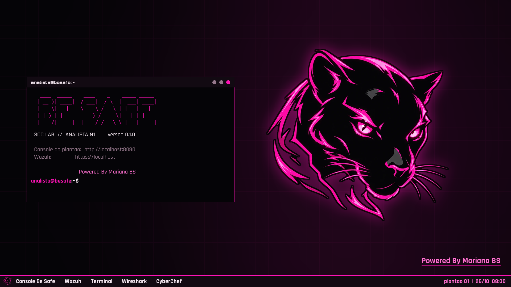
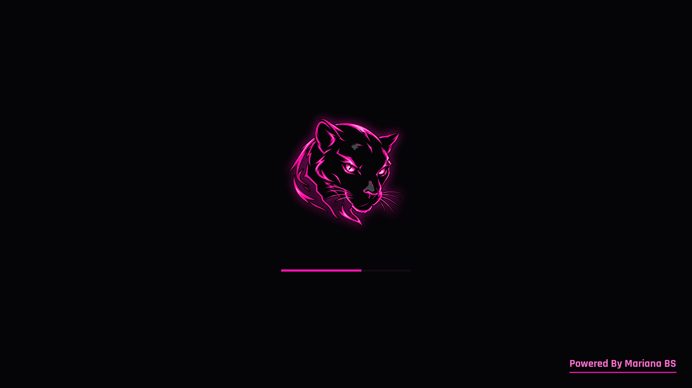

# Be Safe SOC Lab

VM gratuita da Be Safe para formar analistas de SOC nível 1, do zero ao primeiro plantão. Tudo offline: ferramentas de mercado, logs reais de ataques e um treinamento completo, passo a passo, dentro da própria VM.



## O que tem na versão 0.1

- **Treinamento completo em 13 módulos**, pensado para quem está começando, sem ser raso: terminal, redes, Windows pelos logs, fundamentos de SOC, Wazuh, Suricata e Wireshark, caça em logs do Windows, phishing, CyberChef/YARA/Sigma, ticket e plantão, **LGPD para o N1** e um caso final. Glossário e cola de comandos.
- **Labs com dados reais**: centenas de logs gravados em ataques reais a Windows (EVTX-ATTACK-SAMPLES), alertas gerados ao vivo no próprio Wazuh, tráfego capturado e analisado pelo Suricata, e-mails e anexos de treino.
- **Ferramentas de mercado** prontas para uso (tabela abaixo).
- **Identidade Be Safe** no boot, no login, no desktop e no terminal.
- **Segurança da imagem**: senha do Wazuh única por cópia, serviços só em localhost, firewall ativo, SSH desligado.

### Próximas versões

- Console Be Safe: plantões, fila de tickets e nota.
- Telemetria única por aluno (semente própria por instalação).
- IA local e offline: mentor N2, pessoas simuladas e lab de prompt injection.

Detalhes em [docs/arquitetura.md](docs/arquitetura.md).

## Usar a VM

1. Importe a `besafe-soc-lab-<versao>.ova`:
    - **VMware Workstation/Player:** Arquivo > Abrir > a `.ova`.
    - **VirtualBox:** Arquivo > Importar Appliance > a `.ova`.
2. Ligue a VM e entre com as credenciais abaixo.
3. Abra o ícone **Treinamento Be Safe** na área de trabalho e comece pelo módulo 0.

**Requisitos:** host com 16 GB de RAM (a VM usa 12 GB; funciona com 8 GB, mais devagar), 4 núcleos e cerca de 25 GB livres em disco.

### Credenciais

| Onde | Usuário | Senha |
|---|---|---|
| Login da VM e `sudo` | `analista` | `analista` |
| Wazuh dashboard (`https://localhost`, dentro da VM) | `admin` | **única por cópia**, gerada no primeiro boot |

A senha do Wazuh aparece no arquivo **CREDENCIAIS.txt** da área de trabalho, no banner de todo terminal novo e em `~/.besafe/wazuh.txt`. Ela é única para que nenhuma cópia da VM compartilhe a senha de administrador do SIEM com outra.

## O que vem na VM

| Ferramenta | Para quê |
|---|---|
| Wazuh 4.14 | SIEM: alertas, busca, regras, MITRE ATT&CK (`https://localhost`) |
| Suricata + regras ET Open | IDS na interface da VM; os alertas entram no Wazuh |
| Wireshark / tshark | análise de tráfego e PCAP |
| Hayabusa / Chainsaw | caça em logs EVTX do Windows |
| EVTX-ATTACK-SAMPLES | logs reais de ataques (`~/labs/EVTX-ATTACK-SAMPLES`) |
| sigma-cli | escrever e validar regras Sigma |
| YARA | regras para encontrar arquivos pelo conteúdo |
| oletools, pdfid, pdf-parser, exiftool | anexos suspeitos sem executar |
| CyberChef | decodificação offline |
| Firefox (`.deb` da Mozilla), Mousepad | navegador e editor de texto |

## Construir a VM

O build usa [Packer](https://developer.hashicorp.com/packer). O Ansible roda **dentro** da VM, então não precisa estar instalado no host.

**Linux com KVM (recomendado), incluindo WSL2 no Windows:**

```bash
sudo apt install qemu-system-x86 qemu-utils
packer init packer
packer build -only=qemu.besafe -var saida=$HOME/out packer
bash packer/scripts/empacotar.sh $HOME/out/qemu-besafe-soc-lab-0.1.0/besafe-soc-lab-0.1.0.qcow2 vmware/ 0.1.0
```

Depois gere a OVA com o `ovftool` da VMware:

```bash
ovftool --acceptAllEulas --compress=9 vmware/besafe-soc-lab-0.1.0.vmx besafe-soc-lab-0.1.0.ova
```

**VirtualBox:** `packer build -only=virtualbox-iso.besafe packer`. Funciona em hosts **sem** Hyper-V. No Windows com WSL ou Docker (Hyper-V ativo), o VirtualBox trava durante a instalação; use o caminho do QEMU.

O build leva de 35 a 60 minutos e precisa de internet (baixa o Ubuntu, o Wazuh e as ferramentas). A VM resultante funciona offline.

## Estrutura

```
branding/              identidade visual (pantera, paleta, fontes OFL)
packer/                template da VM (QEMU e VirtualBox) e scripts de limpeza e empacotamento
ansible/
  roles/base           usuário do aluno, XFCE, Firefox, firewall
  roles/branding       boot, login, desktop e terminal
  roles/wazuh          Wazuh all-in-one enxuto para lab
  roles/ferramentas    Suricata, Wireshark, Hayabusa, Chainsaw, Sigma, YARA, CyberChef...
  roles/treinamento    gera o treinamento em HTML e a pasta de labs
  roles/primeiro_boot  senhas únicas e credenciais visíveis por cópia
treinamento/
  modulos/             o conteúdo, em Markdown
  labs/                arquivos dos exercícios
  build_html.py        gera as páginas preto e rosa
docs/                  arquitetura e prévias
```

## Licenças de terceiros

- **EVTX-ATTACK-SAMPLES** (Samir Bousseaden): GPL-3.0, distribuído junto com o Chainsaw.
- **Wazuh**, **Suricata**, **Chainsaw**, **Hayabusa**, **CyberChef**, **YARA**, **oletools**: licenças livres de cada projeto.
- Fontes **Orbitron** e **Rajdhani**: SIL Open Font License (em `branding/fonts`).
- Os e-mails e anexos do módulo 8 são de treino e inertes: usam o domínio reservado `.example` e IPs de documentação.



---

Powered By Mariana BS
