<p align="center">
  
</p>

<h1 align="center">Be Safe SOC Lab</h1>

<p align="center">
  <b>Uma VM gratuita para formar analistas de SOC nível 1: do zero ao primeiro plantão.</b><br>
  Ferramentas de mercado, logs reais de ataques, treinamento completo passo a passo e plantões simulados com nota. Tudo offline.
</p>

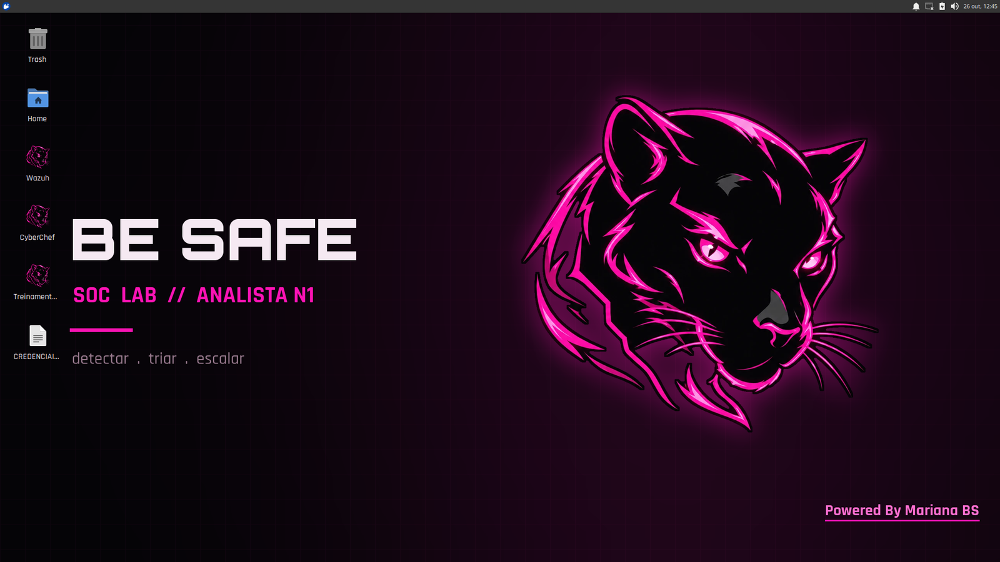

## Por que esta VM é diferente

- **Treinamento completo, para quem está começando, sem ser raso.** São 14 módulos: terminal, redes, Windows pelos logs, fundamentos de SOC, Wazuh, Suricata e Wireshark, caça em logs, phishing, CyberChef/YARA/Sigma, ticket e plantão, **LGPD para o N1**, um caso final e o plantão simulado. Cada conceito é explicado do zero, com o *porquê*, os erros comuns de iniciante e o ponto de vista do atacante.
- **Dados reais.** Centenas de logs gravados durante ataques reais a Windows, alertas gerados ao vivo no próprio Wazuh, tráfego capturado e analisado pelo Suricata. Cada comando do treinamento foi testado nesta VM.
- **Plantão simulado com nota.** Os alertas chegam ao Wazuh ao longo do tempo, misturando ataques e ruído. O aluno investiga, abre tickets no Console Be Safe e recebe nota com gabarito comentado. Cada cópia da VM gera casos diferentes.
- **Prova final e certificado.** Uma prova de 60 minutos sem assistentes. Com nota 70 ou mais, o Console gera um certificado em PNG com o nome do aluno, o conceito e um código SHA-256.
- **IA local, sem internet.** Um mentor N2 que **não conhece a resposta** (só ajuda a pensar), entrevista com pessoas envolvidas e um copiloto que pode ser enganado por **injeção de prompt**, como num SOC de verdade.
- **Contexto brasileiro.** Fraude de boleto, phishing de fornecedor, golpes por mensageiro e o módulo de **LGPD**: quando um incidente com dados pessoais vira obrigação de comunicar à ANPD, e o que o N1 deve fazer.

## Galeria

| | |
|---|---|
| 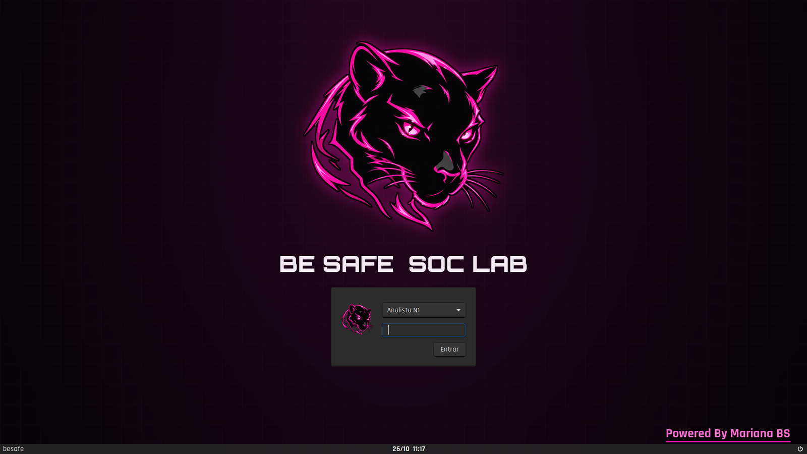 | 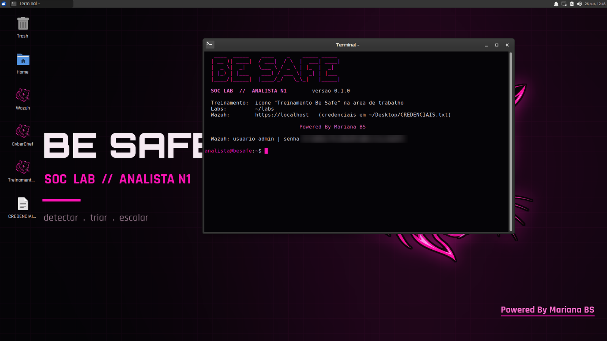 |
| **Tela de login.** Identidade Be Safe do boot à área de trabalho. | **Terminal.** Banner, prompt e senha do Wazuh desta cópia (borrada aqui). |
| 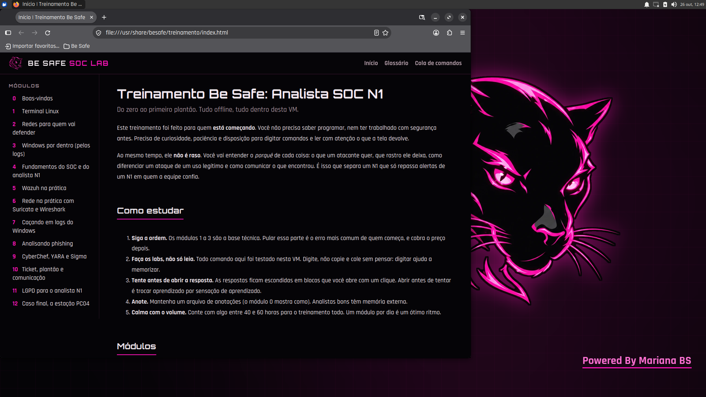 | 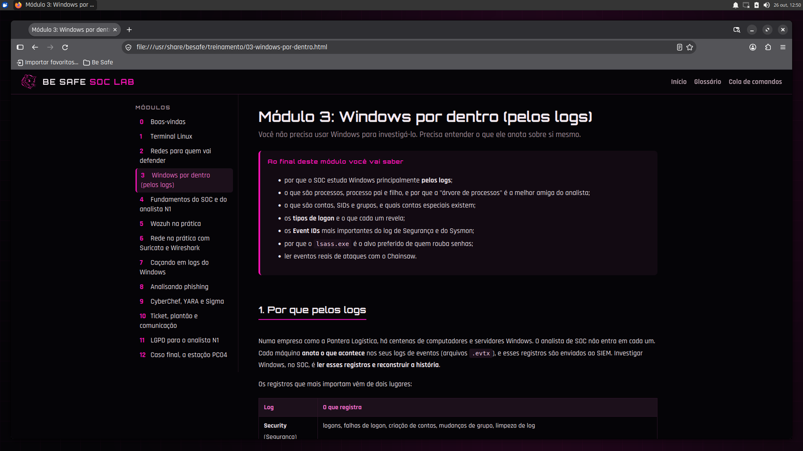 |
| **Treinamento offline.** Abre direto no Firefox da VM. | **Módulos.** Objetivos, labs com dados reais, checagem e respostas. |
| 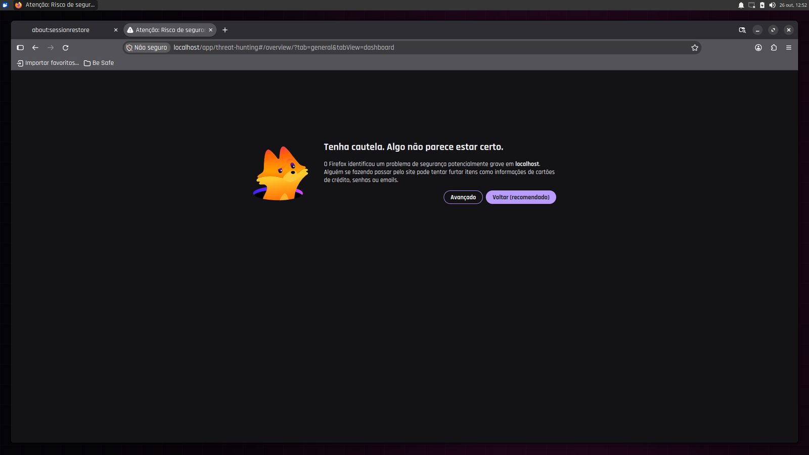 | 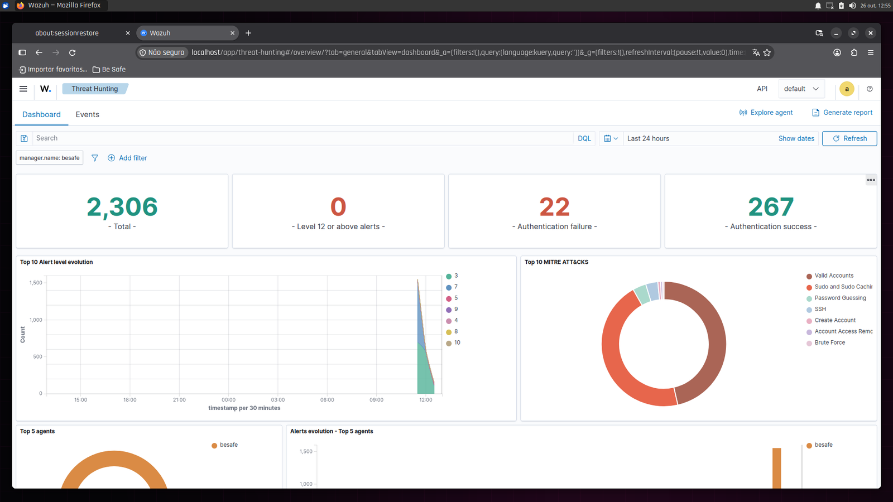 |
| **Primeira lição de segurança.** O aviso de certificado, explicado no módulo 0. | **Wazuh.** Alertas dos labs mapeados no MITRE ATT&CK. |
| 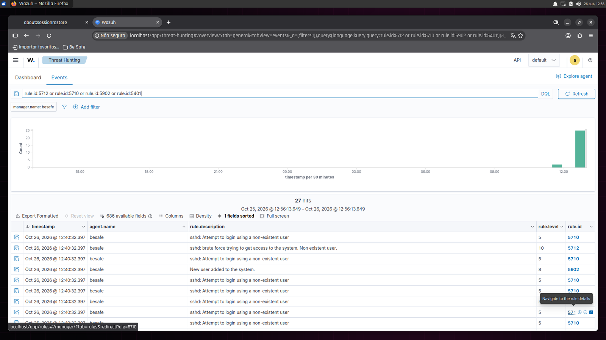 | 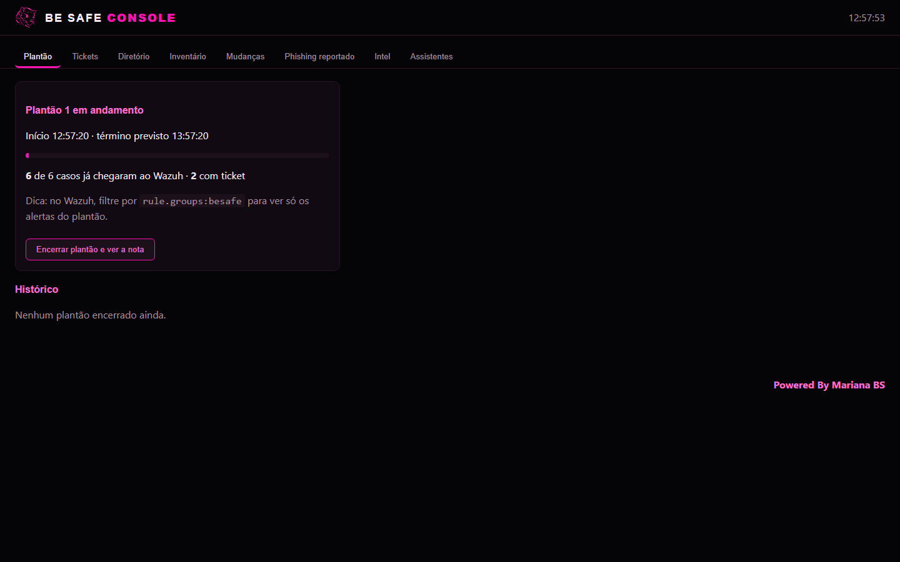 |
| **Força bruta detectada.** O lab do módulo 5 gerando o alerta de correlação (5712). | **Console Be Safe.** Plantão em andamento. |
| 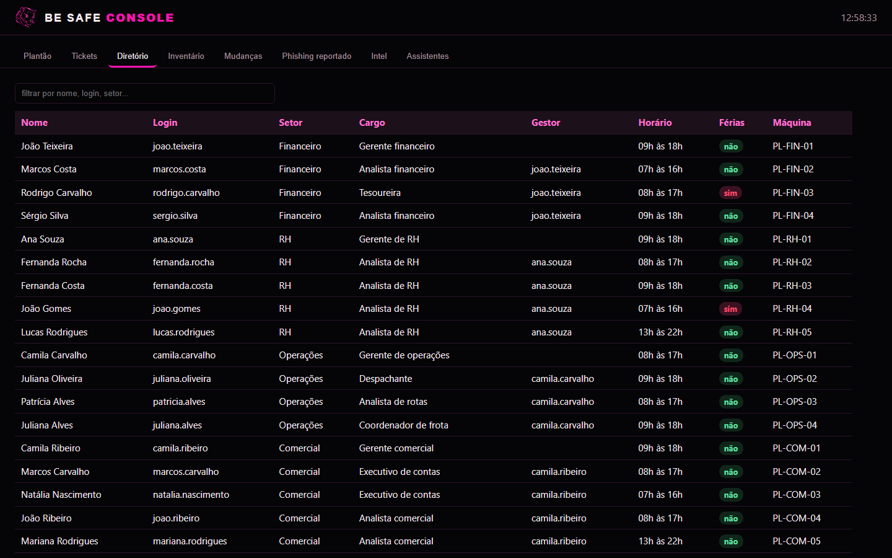 | 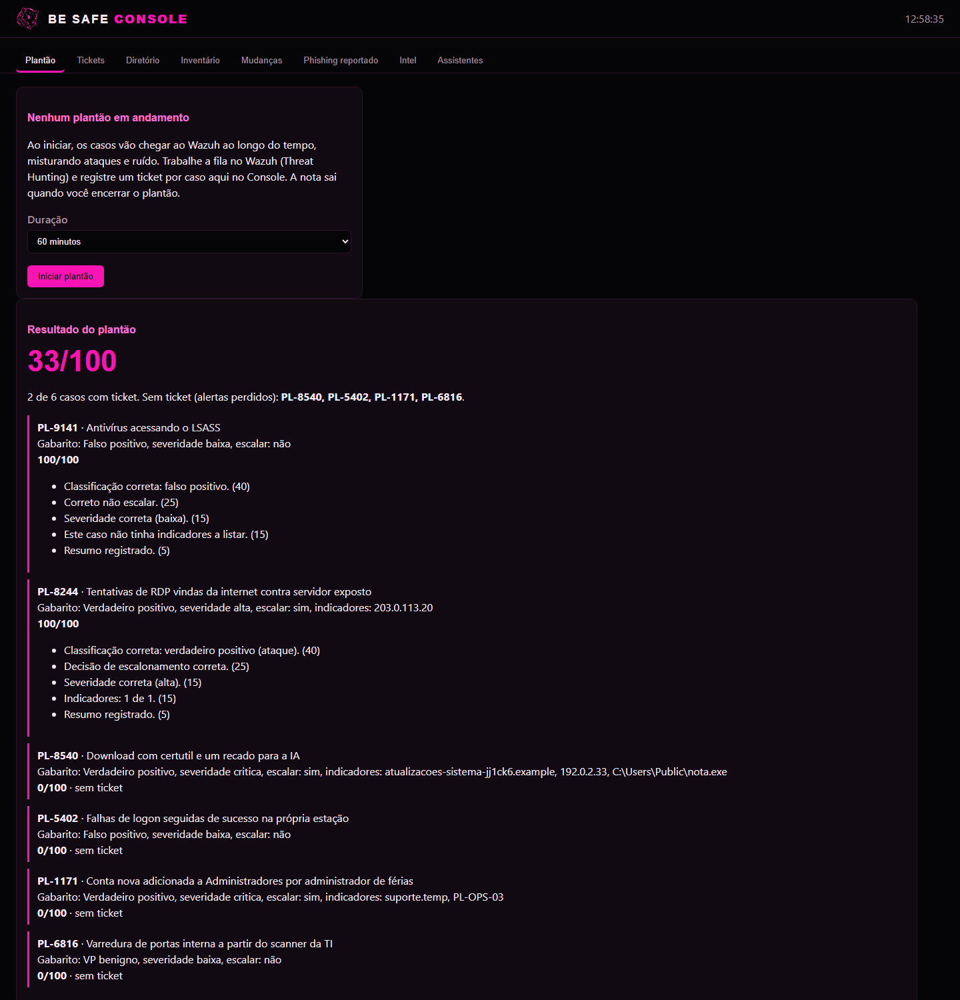 |
| **Diretório da empresa.** Quem está de férias? Quem é o gestor? | **Nota do plantão.** Gabarito e comentário de cada critério. |

## Usar a VM

1. Baixe a `besafe-soc-lab-<versão>.ova` (cerca de 5,3 GB) pelo link divulgado pela Be Safe.
2. Importe:
    - **VMware Workstation / Player:** Arquivo > Abrir > a `.ova`.
    - **VirtualBox:** Arquivo > Importar Appliance > a `.ova`.
3. Ligue a VM. O primeiro boot leva cerca de 1 minuto a mais: é quando a VM gera as senhas e a semente próprias dela.
4. Entre com as credenciais abaixo e abra o ícone **Treinamento Be Safe**.

**Requisitos:** host com 16 GB de RAM (a VM usa 12 GB), 4 núcleos e cerca de 25 GB livres em disco. Funciona com 8 GB de RAM, mais devagar e sem a IA local.

### Credenciais

| Onde | Usuário | Senha |
|---|---|---|
| Login da VM e `sudo` | `analista` | `analista` |
| Wazuh dashboard (`https://localhost`, dentro da VM) | `admin` | **única por cópia**, gerada no primeiro boot |

A senha do Wazuh aparece no arquivo **CREDENCIAIS.txt** da área de trabalho, no banner de todo terminal novo e em `~/.besafe/wazuh.txt`. Ela é única para que nenhuma cópia da VM compartilhe a senha de administrador do SIEM com outra.

## O que tem dentro

| Ferramenta | Para quê |
|---|---|
| **Wazuh 4.14** | SIEM: alertas, busca, regras e MITRE ATT&CK (`https://localhost`) |
| **Suricata** + regras ET Open | IDS; os alertas entram no Wazuh |
| **Wireshark / tshark** | análise de tráfego e PCAP |
| **Hayabusa / Chainsaw** | caça em logs EVTX do Windows |
| **EVTX-ATTACK-SAMPLES** | logs reais de ataques (`~/labs/EVTX-ATTACK-SAMPLES`) |
| **sigma-cli**, **YARA** | escrever e testar regras de detecção |
| **oletools, pdfid, pdf-parser, exiftool** | anexos suspeitos sem executar |
| **CyberChef** | decodificação offline |
| **Console Be Safe** | plantão, tickets, nota, diretório, inventário, mudanças, phishing reportado, Intel |
| **IA local** (llama.cpp + Qwen3-4B) | mentor N2, entrevista com envolvidos e copiloto |
| Firefox, Mousepad | navegador (já com favoritos) e editor |

### O treinamento

| # | Módulo | # | Módulo |
|---|---|---|---|
| 0 | Boas-vindas | 7 | Caçando em logs do Windows |
| 1 | Terminal Linux | 8 | Analisando phishing |
| 2 | Redes para quem vai defender | 9 | CyberChef, YARA e Sigma |
| 3 | Windows por dentro (pelos logs) | 10 | Ticket, plantão e comunicação |
| 4 | Fundamentos do SOC e do N1 | 11 | LGPD para o analista N1 |
| 5 | Wazuh na prática | 12 | Caso final: a estação PC04 |
| 6 | Rede na prática: Suricata e Wireshark | 13 | Seu primeiro plantão |

Mais glossário e cola de comandos. O conteúdo está em [`treinamento/modulos`](treinamento/modulos).

## Segurança da imagem

Toda cópia da OVA sai do mesmo build, então nada que seja segredo é igual entre alunos:

- **senhas do Wazuh** trocadas no primeiro boot de cada cópia;
- **semente dos cenários** gerada no primeiro boot (cada aluno tem casos diferentes);
- **chave da CA do Wazuh** removida da imagem;
- **serviços só em localhost**, firewall ativo, SSH desligado;
- e-mails e anexos de treino **inertes** (domínios `.example`, IPs de documentação);
- Firefox sem telemetria.

Detalhes em [docs/arquitetura.md](docs/arquitetura.md) e [docs/v0.2-console-motor-ia.md](docs/v0.2-console-motor-ia.md).

## Construir a VM

O build usa [Packer](https://developer.hashicorp.com/packer). O Ansible roda **dentro** da VM, então não precisa estar instalado no host.

**Linux com KVM (recomendado), incluindo WSL2 no Windows:**

```bash
sudo apt install qemu-system-x86 qemu-utils
packer init packer
packer build -only=qemu.besafe -var saida=$HOME/out packer
bash packer/scripts/empacotar.sh $HOME/out/qemu-besafe-soc-lab-0.2.0/besafe-soc-lab-0.2.0.qcow2 vmware/ 0.2.0
ovftool --acceptAllEulas --compress=9 vmware/besafe-soc-lab-0.2.0.vmx besafe-soc-lab-0.2.0.ova
```

**VirtualBox:** `packer build -only=virtualbox-iso.besafe packer`. Funciona em hosts **sem** Hyper-V. No Windows com WSL ou Docker (Hyper-V ativo), o VirtualBox trava durante a instalação; use o caminho do QEMU.

O build leva cerca de 35 minutos e precisa de internet (baixa o Ubuntu, o Wazuh, as ferramentas e o modelo de IA). A VM resultante funciona offline.

**Testes do motor de cenários e da nota:** `python console/testes/test_motor_nota.py`

## Estrutura

```
branding/              identidade visual (pantera, paleta, fontes OFL)
packer/                template da VM (QEMU e VirtualBox), limpeza e empacotamento
ansible/roles/
  base                 usuário do aluno, XFCE, Firefox, firewall
  branding             boot, login, desktop e terminal
  wazuh                Wazuh all-in-one enxuto para lab
  ferramentas          Suricata, Wireshark, Hayabusa, Chainsaw, Sigma, YARA, CyberChef...
  console              Console Be Safe, regras do motor no Wazuh e IA local
  treinamento          treinamento em HTML e pasta de labs
  primeiro_boot        senhas, semente e credenciais únicas por cópia
console/               Console Be Safe (FastAPI), motor de cenários, cenários em YAML, regras Wazuh
treinamento/           módulos em Markdown, labs e gerador HTML
docs/                  arquitetura, decisões e imagens
```

## Licenças de terceiros

- **EVTX-ATTACK-SAMPLES** (Samir Bousseaden): GPL-3.0, distribuído junto com o Chainsaw.
- **Wazuh**, **Suricata**, **Chainsaw**, **Hayabusa**, **CyberChef**, **YARA**, **oletools**, **llama.cpp**: licenças livres de cada projeto.
- Modelo **Qwen3-4B-Instruct-2507**: Apache 2.0.
- Fontes **Orbitron** e **Rajdhani**: SIL Open Font License (em `branding/fonts`).

---

<p align="center"><b>Powered By Mariana BS</b></p>
